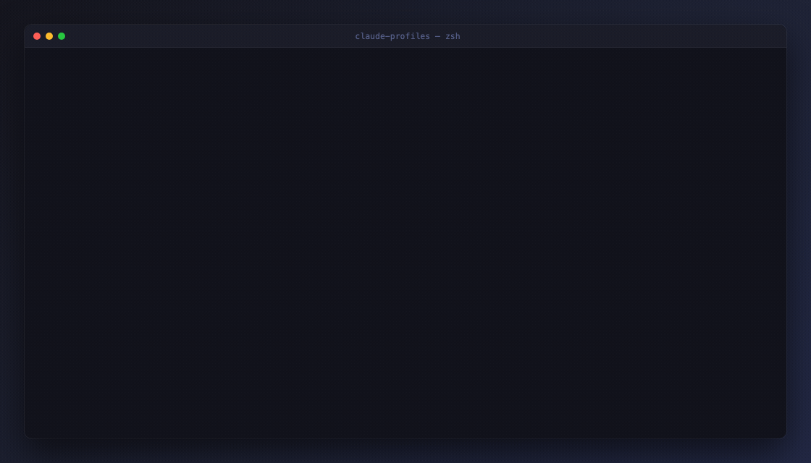

# Session handoff

**What it does, simply:** it moves a conversation from one account to another,
so you can keep going when the first account runs out.

## The problem

You are 50 messages into a conversation. Claude knows your whole problem. Then:

!!! failure "You've hit your usage limit."

Your other account has capacity. But Claude Code cannot see this conversation
from there - each account keeps its own separate history.

## The fix

```sh
claude-handoff work
```

That moves the current conversation into the `work` account's history and
prints the command to continue it:

```
moved session 0a9014e8-8806-43cf-98fd-28fad1353923
  from: default   to: work
  dir : ~/projects/<project-name>/api
  default's copy retired as 0a9014e8-8806-43cf-98fd-28fad1353923.jsonl.bak - undo by renaming it back

  claude-profile work && claude --resume 0a9014e8-8806-43cf-98fd-28fad1353923
```



Run that, and you are back in the same conversation with the same memory - on a
different account with its own quota.

!!! quote "Analogy"
    Like forwarding an email thread to your other address. The thread is
    identical; only the mailbox changed.

## Bringing the project's memory too

Claude Code saves memory per profile and per project, and a plain handoff moves
only the conversation. The conversation carries everything that was said, so you
can keep working - but facts Claude had saved about the project stay behind.

```sh
claude-handoff work --with-memory
```

That merges the saved memory into the other account: new facts are copied,
existing ones are left alone, and if the same fact differs on both sides **both
are kept** so you can decide later. Add `--dry-run` to see the plan first.

[Full detail](../commands/sessions.md#carrying-the-projects-memory-across)

## Handing it back

Once the first account's limit resets you can hand the session back the same
way. Normally the original is a `.bak` by then and the move just works. If you
used `--copy` and both sides have moved on since, the handoff **refuses** rather
than overwriting, and tells you which one is further along:

```
work already has this session and it would be overwritten
  work: 7 turns   personal: 4 turns  - the copy in work is further along
```

`claude-sessions -A -a` marks the leading copy with `*` so you can see where to
resume without counting.

## What it does not do

- **Does not lose anything.** The original is renamed to `<session-id>.jsonl.bak`, not deleted, so a handoff that went somewhere unexpected is one rename from undone.
- **Does not touch your code.** Same project folder, same files, same git branch.
- **Does not transfer your limit.** That is the point: the other account has its own quota.

## One catch

Run it from the folder you were working in. It finds the conversation by which
folder it belongs to.

```sh
cd ~/projects/<project-name>/api
claude-handoff work
```

If you are somewhere else, point at the directory explicitly:

```sh
claude-handoff work -d ~/projects/<project-name>/api
```

## Picking a specific conversation

By default it takes the most recent one. To choose, list them first:

```sh
claude-sessions
```

```
   WHEN      TURNS  SESSION ID                            SUMMARY
 1 2m ago       18  eb82f424-4aff-43eb-a0e1-f1e130553fc6  refactor the auth middleware…
 2 Sep 11        2  2c24a68b-8411-4bb6-9072-99b86b5ae909  cant able to take pull
```

Then pass the id - a prefix is enough:

```sh
claude-handoff work 2c24a68b
```

An ambiguous prefix lists the candidates rather than guessing.

## What actually moves

```
~/.claude/projects/<encoded-dir>/<session-id>.jsonl
        |  copied, preserving the encoded directory name
        v
~/.claude-profiles/work/projects/<encoded-dir>/<session-id>.jsonl

~/.claude/projects/<encoded-dir>/<session-id>.jsonl
        |  then renamed, once the copy is verified byte for byte
        v
~/.claude/projects/<encoded-dir>/<session-id>.jsonl.bak
```

The source is only touched after the target is confirmed identical. If the copy
does not verify, the source is left exactly as it was.

Only the profile root changes. The file is byte-for-byte identical, so every
working directory recorded inside it still points at the original project.

`claude --resume` only looks inside the active profile's `projects/` directory.
That is exactly why handoff is needed - the other account is not hiding the
conversation, it genuinely cannot see the file.

!!! note "Cost"
    Resuming re-sends the conversation to the new account, so its first turn is
    a cold prompt cache and costs more tokens than an ordinary continuation.

## Handing it back

```sh
claude-handoff default
```

Works in either direction, and it is the same operation: the conversation moves
back, and the copy in the profile you left becomes a `.bak`.

## Keeping both copies

Sometimes you want the original left in place - to try something on another
account without committing to it, say.

```sh
claude-handoff work --copy
```

Both profiles then hold the session and continue independently from that point.
`claude-sessions -A -a` marks the one with the most turns with `*`.

To make that your default:

```sh
export CLAUDE_HANDOFF_COPY=1     # before the source line in your rc file
```

`--move` overrides it for a single command.
